# Tutorial 01 — Answers

WIX1002 Fundamentals of Programming: Problem Solving in Programming

## Part I

### Question 1 — Multiply two numbers

#### IPO model

| Input | Process | Output |
| --- | --- | --- |
| Two numbers, `a` and `b` | Calculate `product = a × b` | Product |

#### Pseudocode

```text
START
    READ a, b
    product ← a * b
    PRINT product
END
```

#### Flowchart

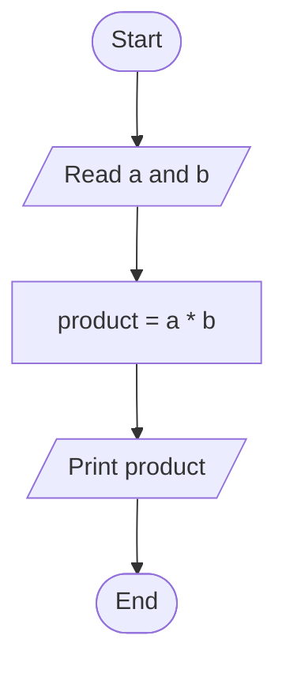

Check: `a = 6`, `b = 7` produces `42`.

### Question 2 — Compare a random number with 50

#### IPO model

| Input | Process | Output |
| --- | --- | --- |
| Computer-generated integer `n` from 1 to 100 | Test `n > 50` | The number and whether it is greater than 50 |

#### Pseudocode

```text
START
    n ← RANDOM_INTEGER(1, 100)
    PRINT n
    IF n > 50 THEN
        PRINT "Greater than 50"
    ELSE
        PRINT "Not greater than 50"
    END IF
END
```

#### Flowchart

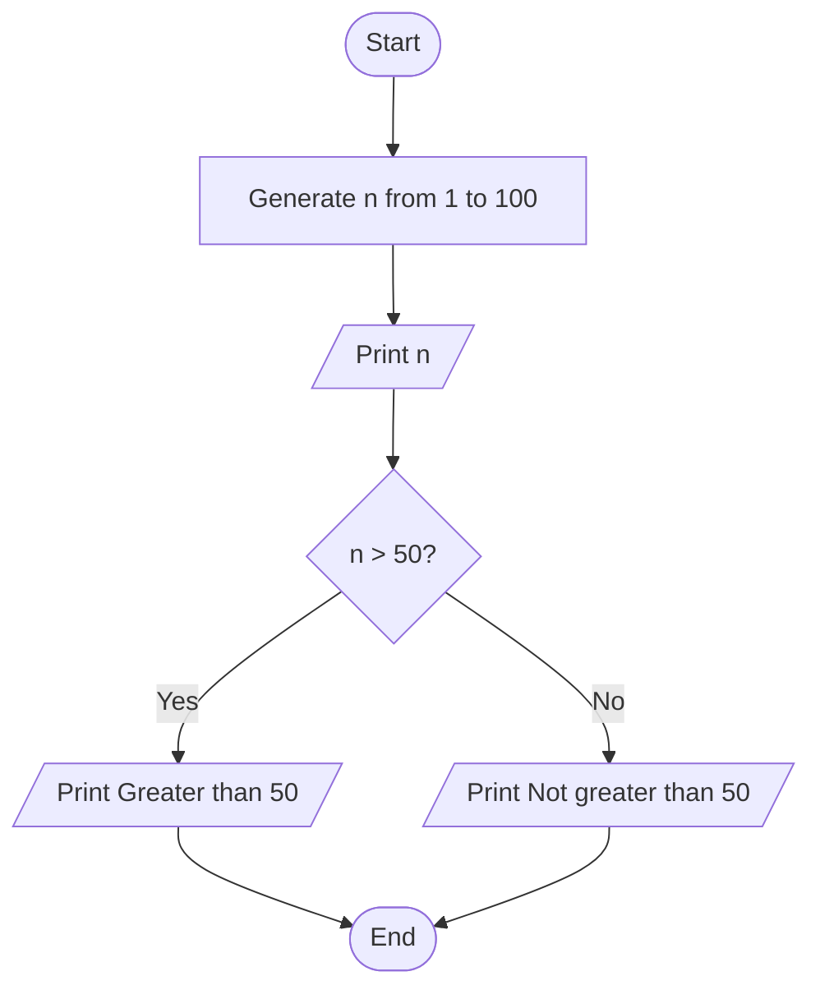

Check: `50` is not greater than 50; `51` is greater than 50.

### Question 3 — Pass or fail

Assume the user enters a valid mark from 0 to 100. The boundary mark 40 is a pass.

#### IPO model

| Input | Process | Output |
| --- | --- | --- |
| Student's mark | Test `mark >= 40` | Pass or Fail |

#### Pseudocode

```text
START
    READ mark
    IF mark >= 40 THEN
        PRINT "Pass"
    ELSE
        PRINT "Fail"
    END IF
END
```

#### Flowchart

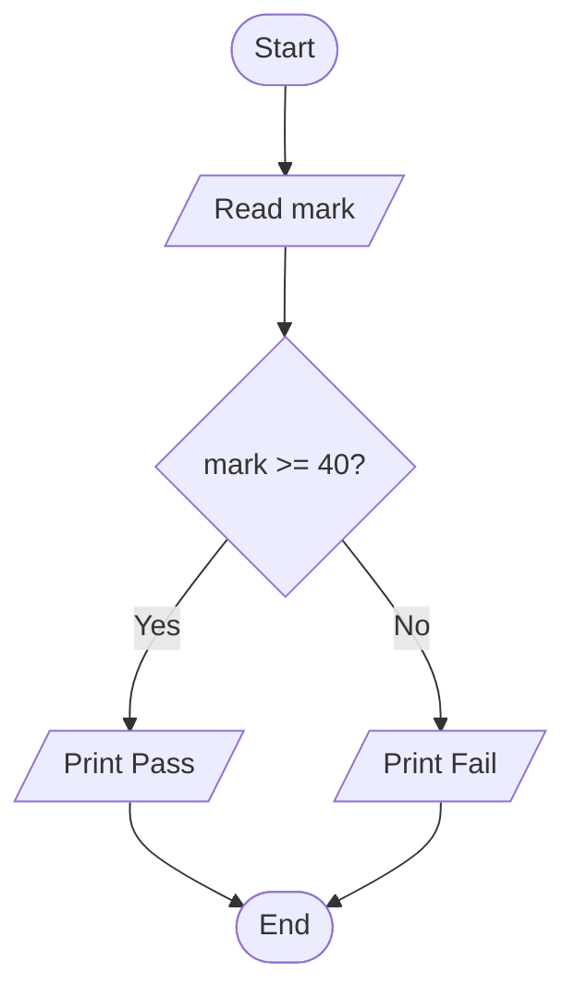

Check: `39 → Fail`, `40 → Pass`.

### Question 4 — Two-player dice game

Assumption: each player rolls one standard six-sided die once. The higher roll wins; equal rolls produce a draw. The PDF does not specify other game rules.

#### IPO model

| Input | Process | Output |
| --- | --- | --- |
| Two generated die rolls, each from 1 to 6 | Compare the rolls | Both rolls and Player 1 wins, Player 2 wins, or Draw |

#### Pseudocode

```text
START
    roll1 ← RANDOM_INTEGER(1, 6)
    roll2 ← RANDOM_INTEGER(1, 6)
    PRINT roll1, roll2
    IF roll1 > roll2 THEN
        PRINT "Player 1 wins"
    ELSE IF roll2 > roll1 THEN
        PRINT "Player 2 wins"
    ELSE
        PRINT "Draw"
    END IF
END
```

#### Flowchart

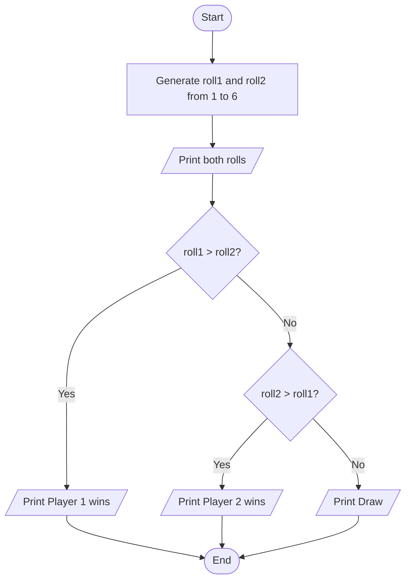

Check: `(6, 2) → Player 1 wins`; `(2, 6) → Player 2 wins`; `(4, 4) → Draw`.

### Question 5 — Rectangle perimeter

Assume length and width are positive and expressed in the same unit.

#### IPO model

| Input | Process | Output |
| --- | --- | --- |
| Rectangle length and width | Calculate `perimeter = 2 × (length + width)` | Perimeter, in the same unit |

#### Pseudocode

```text
START
    READ length, width
    perimeter ← 2 * (length + width)
    PRINT perimeter
END
```

#### Flowchart

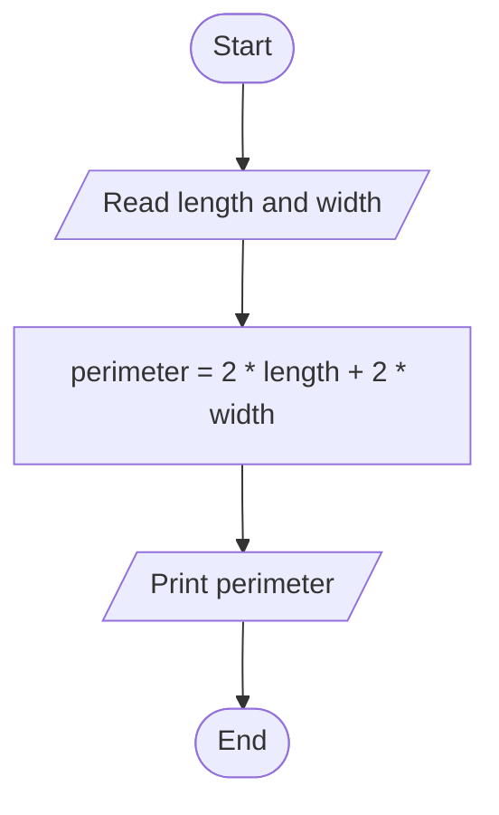

Check: length `5 cm` and width `3 cm` produce `16 cm`.

### Question 6 — Minimum of 10 random numbers

Initialize the minimum with the first generated value, then compare the remaining nine values. This avoids assuming that zero is a suitable initial minimum.

#### IPO model

| Input | Process | Output |
| --- | --- | --- |
| Ten generated integers from 1 to 100 | Keep the smallest value encountered | Minimum of the ten numbers |

#### Pseudocode

```text
START
    minimum ← RANDOM_INTEGER(1, 100)
    i ← 2
    WHILE i <= 10 DO
        n ← RANDOM_INTEGER(1, 100)
        IF n < minimum THEN
            minimum ← n
        END IF
        i ← i + 1
    END WHILE
    PRINT minimum
END
```

#### Flowchart

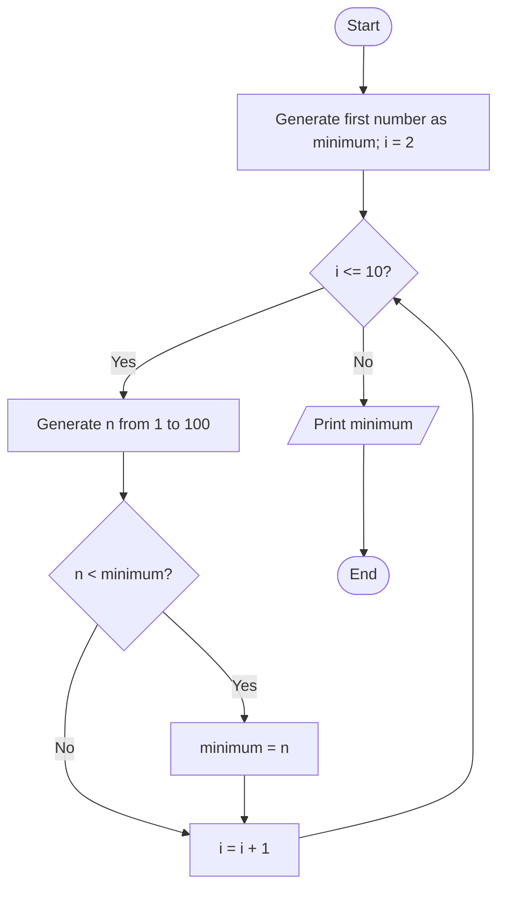

Check: for `42, 17, 83, 17, 9, 60, 35, 91, 28, 54`, the minimum is `9`.

### Question 7 — Count odd and even numbers

Use the required inclusive range 10 to 100. An integer is even when its remainder after division by 2 is zero.

#### IPO model

| Input | Process | Output |
| --- | --- | --- |
| Ten generated integers from 10 to 100 | Test each number using `MOD 2`; increment the appropriate counter | Odd count and even count |

#### Pseudocode

```text
START
    oddCount ← 0
    evenCount ← 0
    i ← 1
    WHILE i <= 10 DO
        n ← RANDOM_INTEGER(10, 100)
        IF n MOD 2 = 0 THEN
            evenCount ← evenCount + 1
        ELSE
            oddCount ← oddCount + 1
        END IF
        i ← i + 1
    END WHILE
    PRINT "Odd:", oddCount
    PRINT "Even:", evenCount
END
```

#### Flowchart

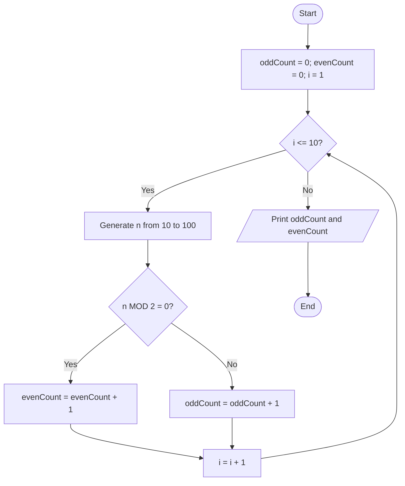

Check: `10, 11, 12, 13, 14, 15, 16, 17, 18, 100` gives `Odd: 4`, `Even: 6`. The counts always sum to 10.

## Part II

### Question 8 — Count U and M in a sentence

Assumption: count uppercase `U` and uppercase `M` separately, as written in the question. Lowercase letters are not counted. For a case-insensitive interpretation, convert the sentence to uppercase before the loop.

#### IPO model

| Input | Process | Output |
| --- | --- | --- |
| A complete sentence, including spaces | Examine each character and count matches for U and M | Separate U and M counts |

#### Pseudocode

```text
START
    READ_LINE sentence
    countU ← 0
    countM ← 0
    i ← 1
    WHILE i <= LENGTH(sentence) DO
        IF sentence[i] = 'U' THEN
            countU ← countU + 1
        ELSE IF sentence[i] = 'M' THEN
            countM ← countM + 1
        END IF
        i ← i + 1
    END WHILE
    PRINT "U:", countU
    PRINT "M:", countM
END
```

#### Flowchart

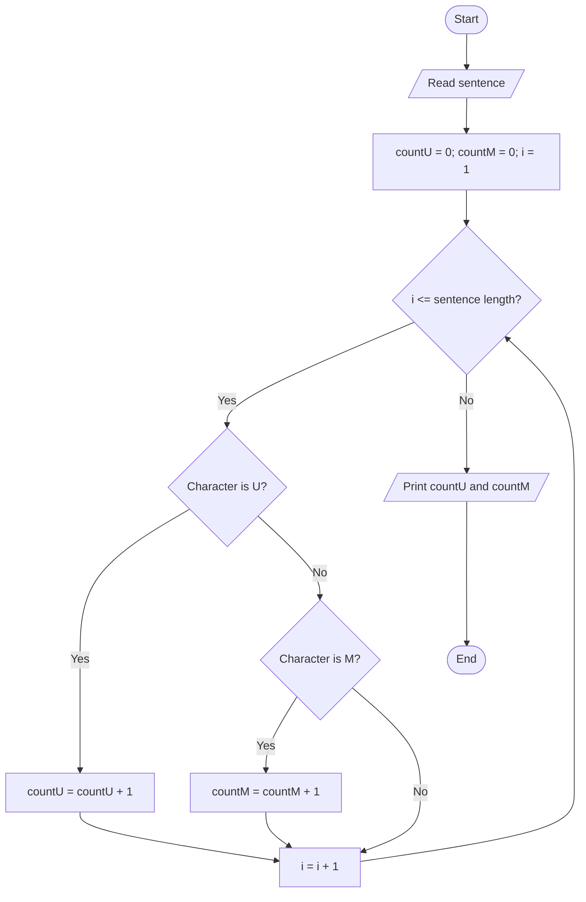

Check: `UM UM um` gives `U: 2`, `M: 2`. An empty sentence gives zero for both.

### Question 9 — Keyword frequency on a web page

Assumptions: the keyword is one word; matching is case-insensitive and whole-word. Count the page's visible text, excluding markup, scripts, and styles. A word is a maximal consecutive sequence of letters or digits. Thus `Java` matches `JAVA`, but not `JavaScript`. Hyphens and punctuation separate words. This solution uses the fetched page's text without executing JavaScript.

#### IPO model

| Input | Process | Output |
| --- | --- | --- |
| Web-page URL and one-word keyword | Fetch page; extract visible text; tokenize; compare normalized words and count matches | Keyword frequency, or an input/retrieval error |

`FETCH` and `EXTRACT_VISIBLE_TEXT` represent web retrieval and HTML parsing operations. `TOKENIZE` splits text into words using the rule above.

#### Pseudocode

```text
START
    READ url, keyword
    keyword ← LOWERCASE(TRIM(keyword))
    IF keyword is not exactly one nonempty letters-or-digits word THEN
        PRINT "Enter a single-word keyword"
        STOP
    END IF
    page, success ← FETCH(url)
    IF success = FALSE THEN
        PRINT "Unable to retrieve web page"
        STOP
    END IF
    text ← EXTRACT_VISIBLE_TEXT(page)
    words ← TOKENIZE(LOWERCASE(text))
    frequency ← 0
    i ← 1
    WHILE i <= LENGTH(words) DO
        IF words[i] = keyword THEN
            frequency ← frequency + 1
        END IF
        i ← i + 1
    END WHILE
    PRINT keyword, frequency
END
```

#### Flowchart

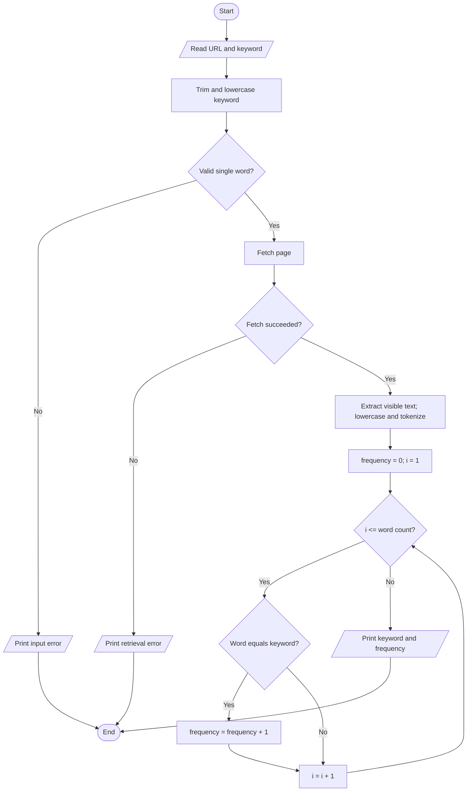

Check: visible text `Java, java! JavaScript.` with keyword `java` gives `2`. No matching words gives `0`.

### Question 10 — Count female students

Assumption: the input is an already supplied random list containing exactly 100 student records, each with a recorded gender field. Count records labelled `Female` or `F`, ignoring case and surrounding spaces. Other values do not increase the count. Do not infer gender from names or generate arbitrary gender values.

#### IPO model

| Input | Process | Output |
| --- | --- | --- |
| List of 100 student records | Inspect every recorded gender and count female entries | Number of female students |

#### Pseudocode

```text
START
    READ students[1..100]
    femaleCount ← 0
    i ← 1
    WHILE i <= 100 DO
        gender ← UPPERCASE(TRIM(students[i].gender))
        IF gender = "FEMALE" OR gender = "F" THEN
            femaleCount ← femaleCount + 1
        END IF
        i ← i + 1
    END WHILE
    PRINT femaleCount
END
```

#### Flowchart

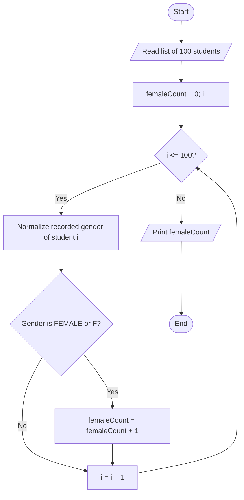

Check: if 57 records are labelled female, output `57`. The result lies between 0 and 100 inclusive.

### Question 11 — Sort five random numbers in descending order

Use bubble sort: swap adjacent values when the left value is smaller. After each pass, the smallest remaining value has moved to the right end of the unsorted section. Equal values are retained.

#### IPO model

| Input | Process | Output |
| --- | --- | --- |
| Five generated integers from 1 to 100 | Compare adjacent values and swap as needed over four passes | Five numbers in descending order |

#### Pseudocode

```text
START
    i ← 1
    WHILE i <= 5 DO
        numbers[i] ← RANDOM_INTEGER(1, 100)
        i ← i + 1
    END WHILE
    pass ← 1
    WHILE pass <= 4 DO
        j ← 1
        WHILE j <= 5 - pass DO
            IF numbers[j] < numbers[j + 1] THEN
                temp ← numbers[j]
                numbers[j] ← numbers[j + 1]
                numbers[j + 1] ← temp
            END IF
            j ← j + 1
        END WHILE
        pass ← pass + 1
    END WHILE
    PRINT numbers[1..5]
END
```

#### Flowchart

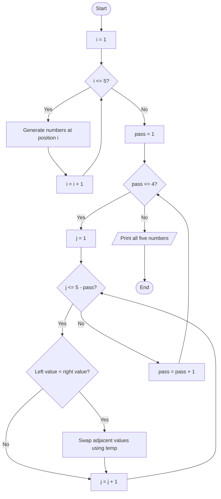

Check: `12, 80, 5, 80, 41` becomes `80, 80, 41, 12, 5`.

### Question 12 — Guess a random number

Assumptions: the computer chooses one integer from 1 to 100. The user repeatedly guesses, receiving a high/low hint until correct. Guesses are valid integers in this range. Generate the target only once, before the guessing loop.

#### IPO model

| Input | Process | Output |
| --- | --- | --- |
| Generated target and successive user guesses | Compare each guess with the fixed target; repeat until equal | Too low, Too high, or Correct |

#### Pseudocode

```text
START
    target ← RANDOM_INTEGER(1, 100)
    PRINT "Guess an integer from 1 to 100"
    READ guess
    WHILE guess != target DO
        IF guess < target THEN
            PRINT "Too low"
        ELSE
            PRINT "Too high"
        END IF
        READ guess
    END WHILE
    PRINT "Correct"
END
```

#### Flowchart

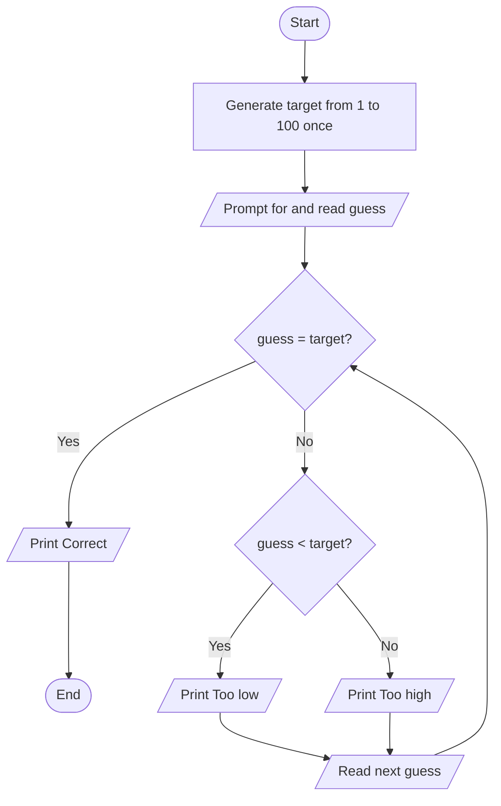

Check: target `60` and guesses `40, 75, 60` produce `Too low`, `Too high`, `Correct`. A correct first guess ends immediately.

