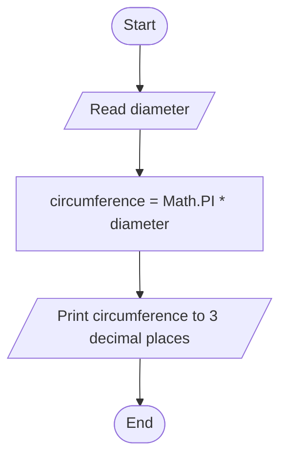
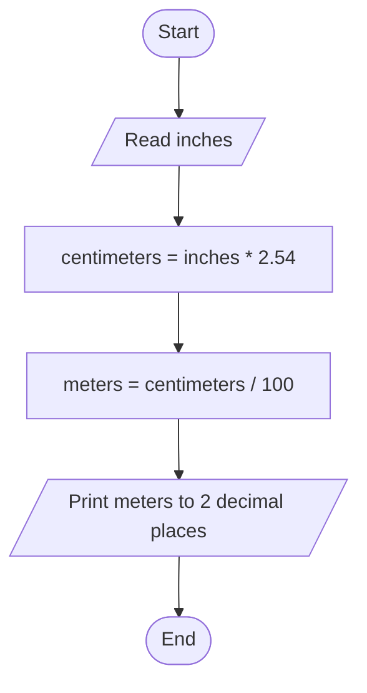

# Tutorial 02 — Answers

WIX1002 Fundamentals of Programming: Java Fundamental

## Question 1 — Display the faculty sentence

### a. One line using multiple Java statements

```java
System.out.print("Faculty ");
System.out.print("of Computer ");
System.out.print("Science and ");
System.out.println("Information Technology.");
```

Each `print` continues on the same line; the last `println` ends the line. Output:

```text
Faculty of Computer Science and Information Technology.
```

### b. Multiple lines using one Java statement

```java
System.out.println("Faculty\nof Computer\nScience and Information\nTechnology.");
```

The escape sequence `\n` starts a new line. Output:

```text
Faculty
of Computer
Science and Information
Technology.
```

## Question 2 — Print an abbreviation and its meaning

```java
System.out.println("\"SDN\" - Software-defined networking");
```

The backslash escapes the quotation marks so they are printed as part of the text.

## Question 3 — Correct the Java statements

### a.

```java
System.out.println("Java Programming");
```

Java method names are case-sensitive: `println`, not `Println`.

### b.

```java
System.out.println("Introduction to Java!");
```

Standard output uses `System.out`, and the statement needs a semicolon.

### c.

The statement is already valid Java:

```java
System.out.println("\t is the horizontal tab character");
```

`\t` is the tab escape sequence. It prints a tab before the text.

### d.

```java
System.out.println("Java is case sensitive!");
```

The class name is `System` with a capital `S`.

## Question 4 — Variable declarations and initializations

### a. Matric number

A matric number may contain letters or leading zeroes, so store it as a `String`:

```java
String matricNumber;
```

### b. Value of π

```java
double pi = Math.PI;
```

### c. Boolean variable `M` set to false

```java
boolean M = false;
```

### d. Variable `P` set to 8,800,000,000

The value is larger than the `int` range, so use `long` and the `L` suffix:

```java
long P = 8800000000L;
```

### e. Character variable `letter` set to U

```java
char letter = 'U';
```

### f. Constant variable `PRO` set to Java

```java
final String PRO = "Java";
```

`final` prevents reassignment; a `String` uses double quotation marks.

## Question 5 — Correct the statements

### a. Constant numeric amount

`AMOUNT` is a constant, so it cannot be changed after initialization. The initial value must be numeric, not a string.

```java
final double AMOUNT = 32.5;
System.out.println("The amount is " + AMOUNT);
```

### b. String variable

Java uses the capitalized type name `String`. Text uses double quotation marks.

```java
String chapter = "Summary";
System.out.println(chapter);
```

### c. Increment and assignment

The original code has an undeclared/uninitialized variable, applies two increment operators to the same expression, and assigns to undeclared `num1`. One valid correction that preserves the apparent intended operations is:

```java
int num = 0;
num++;
num++;
int num1 = num;
```

This starts `num` at zero, increments it twice, then copies it into `num1`. If the exercise intended only one increment, remove one `num++` statement.

### d. Format an integer

`%f` expects a floating-point value. Since `num` is an integer, use `%d`:

```java
int num = 3000;
System.out.printf("%d%n", num);
```

### e. Read a contact line

Use a `Scanner` connected to standard input (`System.in`), not standard output.

```java
import java.util.Scanner;

Scanner keyboard = new Scanner(System.in);
String contact = keyboard.nextLine();
```

## Question 6 — Circumference of a circle

Circumference is `π × diameter`. The program reads the diameter and displays the answer to three decimal places.

### IPO model

| Input | Process | Output |
| --- | --- | --- |
| Circle diameter | `circumference = Math.PI × diameter` | Circumference to three decimal places |

### Pseudocode

```text
START
    READ diameter
    circumference ← Math.PI * diameter
    PRINT circumference to 3 decimal places
END
```

### Flowchart



### Java program

```java
import java.util.Scanner;

public class CircleCircumference {
    public static void main(String[] args) {
        Scanner input = new Scanner(System.in);

        System.out.print("Enter the diameter: ");
        double diameter = input.nextDouble();

        double circumference = Math.PI * diameter;
        System.out.printf("Circumference: %.3f%n", circumference);

        input.close();
    }
}
```

Example: diameter `10` gives approximately `31.416`.

## Question 7 — Convert inches to meters

Given `1 inch = 2.54 cm` and `100 cm = 1 m`, convert using `meters = inches × 2.54 ÷ 100`. Display two decimal places.

### IPO model

| Input | Process | Output |
| --- | --- | --- |
| Length in inches | Convert inches to centimeters, then divide by 100 | Length in meters to two decimal places |

### Pseudocode

```text
START
    READ inches
    centimeters ← inches * 2.54
    meters ← centimeters / 100
    PRINT meters to 2 decimal places
END
```

### Flowchart



### Java program

```java
import java.util.Scanner;

public class InchesToMeters {
    public static void main(String[] args) {
        Scanner input = new Scanner(System.in);

        System.out.print("Enter length in inches: ");
        double inches = input.nextDouble();

        double meters = inches * 2.54 / 100.0;
        System.out.printf("Length in meters: %.2f%n", meters);

        input.close();
    }
}
```

Example: `12` inches is `0.3048` meters, displayed as `0.30` meters.
